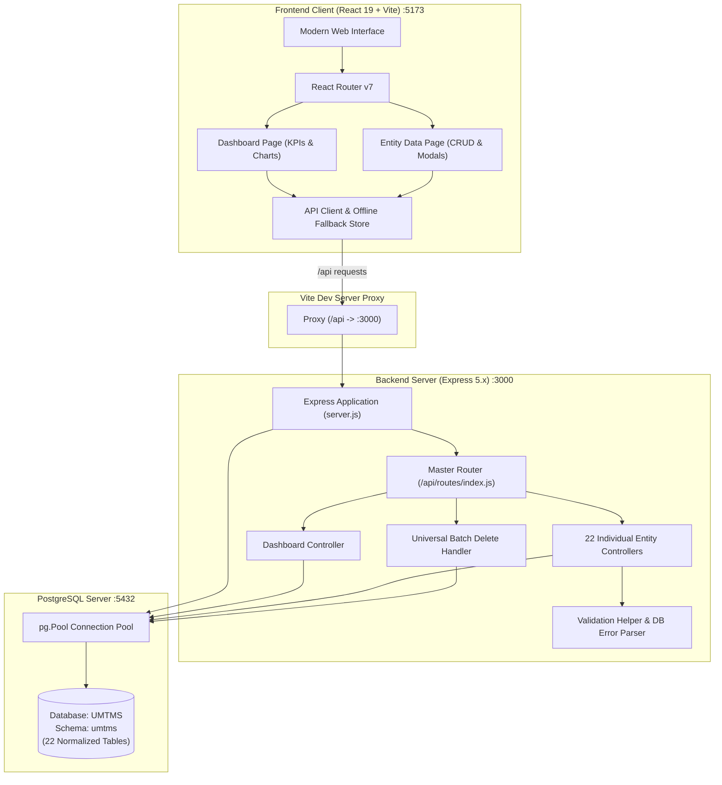

# Urban Multi-Modal Traffic Management System (UMTMS)

[](https://react.dev/)
[](https://vitejs.dev/)
[](https://expressjs.com/)
[](https://nodejs.org/)
[](https://www.postgresql.org/)
[](https://getbootstrap.com/)
[](#license)

> **DBMS Lab - 11 Project** | **DA-IICT (Dhirubhai Ambani University)**  
> An enterprise-grade, full-stack relational database management platform and interactive command center for urban traffic flow monitoring, public transit coordination, violation enforcement, emergency vehicle dispatching, and smart city infrastructure management.

---

## Table of Contents

- [Project Overview](#project-overview)
- [Key Features](#key-features)
  - [1. Executive Analytics & Monitoring Dashboard](#1-executive-analytics--monitoring-dashboard)
  - [2. 22 Relational Database Entities (Full CRUD)](#2-22-relational-database-entities-full-crud)
  - [3. Interactive Data Explorer & Grid](#3-interactive-data-explorer--grid)
  - [4. Recursive Nested Modal Stack for Foreign Keys](#4-recursive-nested-modal-stack-for-foreign-keys)
  - [5. Batch Operations & Bulk Deletion](#5-batch-operations--bulk-deletion)
  - [6. Database Error Mapping & Pre-Validation](#6-database-error-mapping--pre-validation)
  - [7. Resilient Offline Preview & Graceful Degradation](#7-resilient-offline-preview--graceful-degradation)
- [Technology Stack](#technology-stack)
  - [Frontend Architecture](#frontend-architecture)
  - [Backend Architecture](#backend-architecture)
  - [Database & Storage](#database--storage)
- [System Architecture](#system-architecture)
- [Folder Structure](#folder-structure)
- [Database Schema & Relational Model](#database-schema--relational-model)
  - [Schema Overview](#schema-overview)
  - [List of Tables & Primary Keys](#list-of-tables--primary-keys)
  - [Composite Keys & Junction Tables](#composite-keys--junction-tables)
- [Prerequisites](#prerequisites)
- [Installation & Setup](#installation--setup)
  - [1. Clone Repository](#1-clone-repository)
  - [2. Database Configuration](#2-database-configuration)
  - [3. Backend Setup](#3-backend-setup)
  - [4. Frontend Setup](#4-frontend-setup)
- [How to Start the Application](#how-to-start-the-application)
  - [Option A: Running in Separate Terminals (Recommended)](#option-a-running-in-separate-terminals-recommended)
  - [Option B: Windows PowerShell One-Liner](#option-b-windows-powershell-one-liner)
- [REST API Reference](#rest-api-reference)
  - [Dashboard Endpoints](#dashboard-endpoints)
  - [Entity CRUD Endpoints](#entity-crud-endpoints)
  - [Batch Deletion Endpoints](#batch-deletion-endpoints)
- [Design System & UI Highlights](#design-system--ui-highlights)
- [Troubleshooting & FAQs](#troubleshooting--faqs)
- [Authors & Acknowledgments](#authors--acknowledgments)

---

## Project Overview

Modern metropolitan hubs face immense traffic congestion, multi-modal transport synchronization hurdles, emergency response delays, and high rates of traffic infractions. **UMTMS (Urban Multi-Modal Traffic Management System)** is designed as an all-in-one centralized digital operations platform that integrates city-wide transit systems, camera and sensor telemetry, traffic light coordination, violation enforcement records, and emergency fleets into a single cohesive database and responsive web dashboard.

The application adheres to clean **Model-View-Controller (MVC)** backend architecture, backed by a normalized **PostgreSQL** schema (`umtms`), and provides a clean, modern **React 19 + Vite** single-page web interface styled with custom CSS variables, Bootstrap 5, and Bootstrap Icons.

---

## Key Features

### 1. Executive Analytics & Monitoring Dashboard
- **High-Impact KPI Metric Cards**: Live database statistics including total database records across 22 tables, registered vehicle count, fine recovery rate (`%`), infrastructure sensor operational health rate (`%`), emergency fleet readiness score, and aggregate passenger transit capacity.
- **Interactive Visualizations**:
  - **Violations by Violation Type**: Vertical bar chart highlighting citation volume, total fine amounts, and average penalty.
  - **Fine Status Distribution**: Donut chart segmenting Paid, Pending, and Unpaid citations with revenue totals.
  - **Vehicle Fleet Distribution**: Horizontal bar chart categorizing cars, trucks, buses, vans, and motorcycles.
  - **Road Type Distribution**: Donut breakdown of arterial highways, expressways, avenues, and local collectors.
  - **Infrastructure Status**: Visual status breakdown of signals, cameras, and road sensors.
  - **24-Hour Traffic Monitoring Speed vs. Volume Timeline**: Area/trend chart displaying vehicle speed and vehicular density over time.
- **Incident Audit Tables**: Real-time snapshot feeds for top unpaid traffic violations, active emergency response missions, live camera/sensor monitoring logs, and scheduled transit runs.

### 2. 22 Relational Database Entities (Full CRUD)
Complete Create, Read, Update, and Delete operations for every entity in the schema, organized into 5 logical categories:
1. **Transit & Passenger**: Public Transits, Rail Tracks, Trains, Buses, Transit Schedules, Passengers.
2. **Traffic & Enforcement**: Traffic Authorities, Traffic Violations, Traffic Signals, Commits (Violations Junction), Monitored In (3-Way Junction).
3. **Vehicles & Emergency**: Vehicles, Emergency Vehicles, Emergency Responses.
4. **Infrastructure & Sensors**: Roads, Intersections, Traffic Cameras, Road Sensors, Traffic Monitoring Records.
5. **Urban Planning & Geographic Data**: Historical Traffic Data, Locations, City Planners.

### 3. Interactive Data Explorer & Grid
- **Global Instant Search**: Filter table rows dynamically across all attributes in real-time.
- **Multi-Column Sorting**: Ascending and descending sort toggles with clean visual indicators.
- **Configurable Pagination**: Switch between 5, 10, 20, or 50 records per page.
- **Dynamic Formatting & Badges**: Color-coded badges for status flags (e.g., `ACTIVE`, `PENDING`, `PAID`, `OPERATIONAL`), formatted currency values (`₹`), timestamps, and coordinate notation.
- **Advanced Multi-Criteria Filtering**: Filter modal allowing users to construct precision queries using operators (`equals`, `contains`, `starts_with`, `ends_with`, `greater_than`, `less_than`, `not_equals`).

### 4. Recursive Nested Modal Stack for Foreign Keys
- Clickable foreign key ID badges open an interactive modal showing the referenced parent or child record.
- **Stackable Modal Navigation**: If the opened record references yet another entity (e.g., *Violation* $\rightarrow$ *Vehicle* $\rightarrow$ *Location*), clicking the inner foreign key stacks an additional overlay modal with smooth depth-scaling animations without losing the parent context.

### 5. Batch Operations & Bulk Deletion
- Table checkboxes allow single-row or page-wide multi-row selection.
- Floating action bar displays selection count and enables one-click **Bulk Deletion** supported by backend transaction batch handlers for both single and composite primary keys.

### 6. Database Error Mapping & Pre-Validation
- Pre-validation layer verifies required fields and numeric ranges before database query execution.
- Translates PostgreSQL error codes into readable, field-specific error messages:
  - `23505`: Unique constraint violation (e.g., duplicate registration number or track code).
  - `23503`: Foreign key constraint failure (e.g., referenced location or authority does not exist).
  - `23502`: Not-null field omissions.
  - `22P02`: Numeric and data format mismatches.
  - `22001`: String length overflow.

### 7. Resilient Offline Preview & Graceful Degradation
- If the PostgreSQL database or backend API server is offline or unreachable, the frontend seamlessly falls back to pre-loaded preview datasets.
- Warning banners and refresh controls indicate whether data is served from the live server or the local preview cache.

---

## Technology Stack

### Frontend Architecture
| Technology | Version | Purpose |
| :--- | :--- | :--- |
| **React** | `^19.3.1` | Declarative component UI library |
| **Vite** | `^8.3.6` | Next-generation dev server & module bundler |
| **React Router DOM** | `^7.18.5` | Dynamic client-side routing & route parameters |
| **Bootstrap** | `^5.3.8` | Responsive grid foundation & utility classes |
| **Bootstrap Icons** | `^1.13.2` | Comprehensive SVG iconography suite |
| **Custom CSS Design System** | Native CSS3 | Modern design tokens, custom cards, table styling, and responsive layout |

### Backend Architecture
| Technology | Version | Purpose |
| :--- | :--- | :--- |
| **Node.js** | `v18+` / `v20+` | JavaScript runtime environment (ES Modules) |
| **Express** | `^5.3.0` | Minimalist web application and REST API framework |
| **pg (node-postgres)** | `^8.23.1` | PostgreSQL client with high-concurrency connection pooling |
| **cors** | `^2.8.6` | Cross-Origin Resource Sharing middleware |
| **body-parser** | `^2.4.0` | HTTP request body parsing middleware |

### Database & Storage
| Technology | Details | Purpose |
| :--- | :--- | :--- |
| **PostgreSQL** | Relational DB (`UMTMS`) | ACID-compliant relational data storage |
| **Schema Name** | `umtms` | Isolated namespace for all 22 project relations |
| **Connection Pooling** | Max 20 connections, 30s timeout | Optimized connection reuse and resource management |

---

## System Architecture



---

## Folder Structure

```text
Lab - 11 UMTMS/
├── .gitignore                      # Git ignored files & node_modules
├── README.md                       # Comprehensive project documentation
│
├── client/                         # Frontend Application (React 19 + Vite)
│   ├── index.html                  # HTML5 application entry point
│   ├── package.json                # Frontend dependencies & npm scripts
│   ├── vite.config.js              # Vite bundler config with /api proxy to backend
│   ├── eslint.config.js            # Code quality and linting configuration
│   │
│   ├── public/                     # Public static assets & favicon
│   │   ├── favicon.svg             # Application logo icon
│   │   └── icons.svg               # SVG icons bundle
│   │
│   └── src/
│       ├── main.jsx                # Application root mounting & global styles
│       ├── App.jsx                 # Top-level routing (all 22 dynamic entity routes)
│       ├── App.css                 # Application-level layout styles
│       ├── index.css               # Base CSS variables & typography
│       │
│       ├── api/
│       │   └── apiClient.js        # Universal CRUD fetcher, error handler & fallback store
│       │
│       ├── config/
│       │   └── routesConfig.js     # Master entity schemas, columns, icons & fallback data
│       │
│       ├── layout/
│       │   ├── Layout.jsx          # Shell layout wrapper (Sidebar + Header + Content)
│       │   ├── Sidebar.jsx         # Collapsible sidebar with grouped navigation
│       │   └── TopHeader.jsx       # Mobile top bar with hamburger menu trigger
│       │
│       ├── pages/
│       │   ├── DashboardPage.jsx   # Analytics dashboard with KPIs, charts & recent feeds
│       │   ├── EntityDataPage.jsx  # Reusable data table page for all 22 entities
│       │   └── NotFoundPage.jsx    # Clean 404 error page with navigation back home
│       │
│       ├── components/
│       │   ├── common/
│       │   │   ├── AddEditModal.jsx        # Dynamic form modal for Create & Update
│       │   │   ├── DataTable.jsx           # Main data grid with badges, sorting & FK buttons
│       │   │   ├── DeleteConfirmModal.jsx  # Safe confirmation dialog for single & bulk deletes
│       │   │   ├── ErrorAlert.jsx          # Dismissible contextual alert banners
│       │   │   ├── FilterModal.jsx         # Multi-criteria column filter builder
│       │   │   ├── LoadingSkeleton.jsx     # Shimmer skeleton loader for tables & cards
│       │   │   ├── Pagination.jsx          # Page number controls & pagination info
│       │   │   ├── RelatedRecordModal.jsx  # Recursive stacked overlay modal for FK lookups
│       │   │   ├── ToastNotification.jsx   # Floating toast alerts for operations
│       │   │   └── Toolbar.jsx             # Search bar, per-page selector & action buttons
│       │   │
│       │   └── dashboard/
│       │       ├── AreaTrendChart.jsx      # SVG area trend chart (Speed vs Volume)
│       │       ├── BarChart.jsx            # Dynamic vertical bar chart (Violations)
│       │       ├── DonutChart.jsx          # SVG segmented donut chart (Fines & Health)
│       │       ├── HorizontalBarChart.jsx  # Horizontal bar chart with icons (Vehicles)
│       │       ├── StatCard.jsx            # KPI metric cards with trends & icons
│       │       └── TopRecordsSection.jsx   # Tabbed quick-view table of recent activity
│       │
│       ├── styles/
│       │   ├── theme.css           # Custom design system tokens, modals, tables & buttons
│       │   └── dashboard.css       # Dedicated dashboard grid & visualization styles
│       │
│       └── utils/
│           └── formatters.js       # Formatters for currency, timestamps, coordinates & badges
│
└── server/                         # Backend Application (Node.js + Express 5)
    ├── package.json                # Backend dependencies & scripts (start, dev)
    ├── server.js                   # Express server initialization & middleware config
    │
    ├── db/
    │   └── db.js                   # PostgreSQL connection pool configuration
    │
    ├── utils/
    │   └── validationHelper.js     # Schema validation rules & Postgres error code parser
    │
    ├── routes/
    │   ├── index.js                # Master router exposing all entity & dashboard endpoints
    │   ├── dashboardRoutes.js      # Dashboard aggregation route
    │   ├── batchRoutes.js          # Universal bulk deletion route
    │   ├── busRoutes.js            # Bus entity router
    │   ├── cityPlannerRoutes.js    # City planner entity router
    │   ├── commitsRoutes.js        # Commits junction router
    │   ├── emergencyResponseRoutes.js # Emergency response router
    │   ├── emergencyVehicleRoutes.js  # Emergency vehicle router
    │   ├── historicalTrafficDataRoutes.js # Historical traffic data router
    │   ├── intersectionRoutes.js   # Intersection router
    │   ├── locationRoutes.js       # Geographic location router
    │   ├── monitoredInRoutes.js    # Monitored In junction router
    │   ├── passengerRoutes.js      # Passenger router
    │   ├── publicTransitRoutes.js  # Public transit router
    │   ├── railTrackRoutes.js      # Rail track router
    │   ├── roadRoutes.js           # Road network router
    │   ├── roadSensorRoutes.js     # Road sensor router
    │   ├── trafficAuthorityRoutes.js # Traffic authority router
    │   ├── trafficCameraRoutes.js  # Traffic camera router
    │   ├── trafficMonitoringRecordRoutes.js # Traffic monitoring record router
    │   ├── trafficSignalRoutes.js  # Traffic signal router
    │   ├── trafficViolationRoutes.js # Traffic violation router
    │   ├── trainRoutes.js          # Train router
    │   ├── transitScheduleRoutes.js# Transit schedule router
    │   └── vehicleRoutes.js        # Vehicle router
    │
    └── controller/
        ├── dashboardController.js  # Multi-table SQL aggregations & KPI computations
        ├── busController.js
        ├── cityPlannerController.js
        ├── commitsController.js
        ├── emergencyResponseController.js
        ├── emergencyVehicleController.js
        ├── historicalTrafficDataController.js
        ├── intersectionController.js
        ├── locationController.js
        ├── monitoredInController.js
        ├── passengerController.js
        ├── publicTransitController.js
        ├── railTrackController.js
        ├── roadController.js
        ├── roadSensorController.js
        ├── trafficAuthorityController.js
        ├── trafficCameraController.js
        ├── trafficMonitoringRecordController.js
        ├── trafficSignalController.js
        ├── trafficViolationController.js
        ├── trainController.js
        ├── transitScheduleController.js
        └── vehicleController.js
```

---

## Database Schema & Relational Model

### Schema Overview
All tables are organized within the `umtms` schema inside the `UMTMS` PostgreSQL database to ensure clean namespace isolation.

### List of Tables & Primary Keys

| Category | Table Name | Primary Key | Foreign Keys / References | Description |
| :--- | :--- | :--- | :--- | :--- |
| **Transit** | `umtms.public_transit` | `transit_id` | — | Transit modes (BRT, Metro, Bus, etc.) |
| **Transit** | `umtms.rail_track` | `track_id` | — | Railway tracks and track availability |
| **Transit** | `umtms.train` | `train_id` | `transit_id`, `track_id` | Rail fleet, capacities, and assigned tracks |
| **Transit** | `umtms.bus` | `bus_id` | `transit_id` | City buses, route codes, and passenger capacity |
| **Transit** | `umtms.transit_schedule`| `schedule_id` | `bus_id`, `train_id` | Timetables, departure/arrival schedules |
| **Transit** | `umtms.passenger` | `passenger_id` | `bus_id`, `train_id` | Commuter ridership counts per transit unit |
| **Enforcement**| `umtms.traffic_authority`| `authority_id` | — | Police divisions and smart traffic commands |
| **Enforcement**| `umtms.traffic_violation`| `violation_id` | `authority_id` | Citations, fine amounts, and payment statuses |
| **Enforcement**| `umtms.traffic_signal` | `signal_id` | `authority_id` | Signal timing patterns and operational statuses |
| **Junction** | `umtms.commits` | `(vehicle_id, violation_id)` | `vehicle_id`, `violation_id` | Associates vehicles with committed infractions |
| **Junction** | `umtms.monitored_in` | `(vehicle_id, signal_id, violation_id)` | `vehicle_id`, `signal_id`, `violation_id` | 3-way junction linking vehicle, signal, and violation |
| **Vehicles** | `umtms.vehicle` | `vehicle_id` | — | Motor vehicles and registration plate numbers |
| **Emergency** | `umtms.emergency_vehicle`| `emergency_vehicle_id` | `location_id` | Ambulances, fire engines, patrol cars |
| **Emergency** | `umtms.emergency_response`| `response_id` | `emergency_id` | Active dispatch missions and response stages |
| **Sensors** | `umtms.road` | `road_id` | — | Road corridors, expressways, and avenue names |
| **Sensors** | `umtms.intersection` | `intersection_id` | `location_id`, `signal_id` | Junction points and crossroad intersections |
| **Sensors** | `umtms.traffic_camera` | `camera_id` | `road_id`, `record_id`, `location_id` | ANPR cameras, speed domes, and panoramic cameras |
| **Sensors** | `umtms.road_sensor` | `sensor_id` | `road_id`, `location_id` | Inductive loops, radar, and acoustic traffic sensors |
| **Sensors** | `umtms.traffic_monitoring_record`| `record_id` | `road_id`, `sensor_id`, `camera_id`, `history_id` | Speed measurements and vehicle volume logs |
| **Planning** | `umtms.historical_traffic_data`| `history_id` | `planner_id` | Aggregated traffic flow trends and historical patterns |
| **Planning** | `umtms.location` | `location_id` | — | Geographic GPS coordinates (Latitude, Longitude) |
| **Planning** | `umtms.city_planner` | `planner_id` | — | Urban mobility engineers and city planners |

### Composite Keys & Junction Tables
- **`umtms.commits`**: Has a composite primary key `(vehicle_id, violation_id)`. Both backend routes and frontend controls natively support multi-part ID operations.
- **`umtms.monitored_in`**: Uses a 3-way composite primary key `(vehicle_id, signal_id, violation_id)`.

---

## Prerequisites

Before setting up the project, make sure the following software is installed on your workstation:

- **Node.js**: `v18.0.0` or higher (tested on Node `v20.x` and `v22.x`)
- **npm**: `v9.0.0` or higher (comes bundled with Node.js)
- **PostgreSQL**: `v14.0` or higher
- **Git**: Installed and configured on your system

---

## Installation & Setup

### 1. Clone Repository
```bash
git clone https://github.com/aarshpatel1/DBMS-Lab-11-UMTMS.git
cd "DBMS-Lab-11-UMTMS"
```

### 2. Database Configuration
1. Open PostgreSQL using **pgAdmin** or `psql`:
   ```sql
   CREATE DATABASE "UMTMS";
   \c "UMTMS";
   CREATE SCHEMA IF NOT EXISTS umtms;
   ```
2. Check database connection configuration in [server/db/db.js](file:///f:/DAIICT%20(DAU)/DBMS/Lab%20-%2011%20UMTMS/server/db/db.js):
   ```javascript
   const pool = new pg.Pool({
     user: "postgres",
     host: "localhost",
     database: "UMTMS",
     password: "your_postgres_password", // Update with your local password
     port: 5432,
     max: 20,
     idleTimeoutMillis: 30000,
     connectionTimeoutMillis: 5000,
   });
   ```

### 3. Backend Setup
Navigate to the `server` directory and install dependencies:
```bash
cd server
npm install
```

### 4. Frontend Setup
Navigate to the `client` directory and install dependencies:
```bash
cd ../client
npm install
```

---

## How to Start the Application

### Option A: Running in Separate Terminals (Recommended)

#### Terminal 1 — Start the Backend Server:
```bash
cd server
npm start
# Alternatively, for development with auto-reload:
# npm run dev
```
Output:
```text
Server is running at http://localhost:3000
```

#### Terminal 2 — Start the Frontend Client:
```bash
cd client
npm run dev
```
Output:
```text
  VITE v8.3.6  ready in 250 ms

  ➜  Local:   http://localhost:5173/
  ➜  Network: use --host to expose
```

Open your browser and navigate to: **`http://localhost:5173`**

---

### Option B: Windows PowerShell One-Liner
From the root project folder, you can launch both the backend and frontend in parallel:
```powershell
Start-Process powershell -ArgumentList "-NoExit", "-Command", "cd server; npm start"
Start-Process powershell -ArgumentList "-NoExit", "-Command", "cd client; npm run dev"
```

---

## REST API Reference

Base URL: `http://localhost:3000/api`

### Dashboard Endpoints
| Method | Endpoint | Description |
| :--- | :--- | :--- |
| `GET` | `/api/dashboard/summary` | Complete analytical summary: multi-table counts, KPIs, chart breakdowns, top records, and timeline feeds |

### Entity CRUD Endpoints
All 22 entities share standard RESTful conventions:

| Method | Endpoint Pattern | Description |
| :--- | :--- | :--- |
| `GET` | `/api/<entity-key>` | Fetch all records for the specified entity |
| `GET` | `/api/<entity-key>/:id` | Fetch a single record by primary key |
| `POST` | `/api/<entity-key>` | Create a new entity record |
| `PUT` | `/api/<entity-key>/:id` | Update an existing record by primary key |
| `DELETE` | `/api/<entity-key>/:id` | Delete a record by primary key |

#### Supported Entity Keys:
- `/api/public-transits`
- `/api/rail-tracks`
- `/api/trains`
- `/api/buses`
- `/api/transit-schedules`
- `/api/passengers`
- `/api/traffic-authorities`
- `/api/traffic-violations`
- `/api/traffic-signals`
- `/api/commits`
- `/api/monitored-in`
- `/api/vehicles`
- `/api/emergency-vehicles`
- `/api/emergency-responses`
- `/api/roads`
- `/api/intersections`
- `/api/traffic-cameras`
- `/api/road-sensors`
- `/api/traffic-monitoring-records`
- `/api/historical-traffic-data`
- `/api/locations`
- `/api/city-planners`

*(Singular aliases like `/api/vehicle` or `/api/bus` are also supported for convenience.)*

### Batch Deletion Endpoints
| Method | Endpoint | Description |
| :--- | :--- | :--- |
| `POST` | `/api/batch-delete/:entityKey` | Deletes multiple records simultaneously by passing an array of IDs in the request body |

**Sample Batch Delete Request Body:**
```json
{
  "ids": [101, 102, 103]
}
```

---

## Design System & UI Highlights

- **Palette & Typography**:
  - Primary Brand Accent: Royal Purple (`#7f56d9`)
  - Semantic Status Colors: Emerald Success (`#12b76a`), Amber Warning (`#f79009`), Crimson Danger (`#d92d20`), Cobalt Info (`#175cd3`)
  - Neutral Scale: Premium slate tones (`#101828`, `#344054`, `#475467`, `#667085`, `#f8f9fa`)
- **Responsive Layout**: Collapsible sidebar navigation with group headings, mobile off-canvas drawer, sticky toolbar headers, and adaptive data tables with horizontal scrolling on smaller viewports.
- **Micro-Interactions**: Hover states on table rows, subtle button scaling, animated shimmer loading skeletons, spinning refresh icons, and stacked modal transitions with z-index layering.

---

## Troubleshooting & FAQs

### Q1: The backend fails with `ECONNREFUSED 127.0.0.1:5432`
- Ensure the PostgreSQL service is actively running.
- In Windows Services, verify that `postgresql-x64-<version>` is set to **Running**.
- Confirm that the database name `UMTMS` and the password in `server/db/db.js` match your local PostgreSQL configuration.

### Q2: The tables show "Offline Preview" badge
- This is an intentional resilience feature. When the frontend cannot reach the backend API at `http://localhost:3000`, it seamlessly falls back to pre-populated preview data so you can continue testing the interface.
- Once you start the backend server and click **Refresh**, it switches to live PostgreSQL data.

### Q3: How do I change the backend port?
- Modify `const port = 3000;` in `server/server.js`.
- If you change the backend port (e.g., to `5000`), update the proxy target in `client/vite.config.js`:
  ```javascript
  server: {
    proxy: {
      '/api': {
        target: 'http://localhost:5000',
        changeOrigin: true,
      },
    },
  }
  ```

### Q4: Composite key tables (commits / monitored-in)
- For composite key tables, single deletion requires matching all composite key values, which the application automatically handles when you click the trash button or select multiple rows.

---

## Authors & Acknowledgments

- **Aarsh Patel** ([@aarshpatel1](https://github.com/aarshpatel1))
- **Course**: Database Management Systems (DBMS Lab - 11)
- **Institution**: Dhirubhai Ambani Institute of Information and Communication Technology (DA-IICT / DAU)

---

## License

This project was developed for academic coursework at DA-IICT. Released under the [MIT License](https://opensource.org/licenses/MIT).
